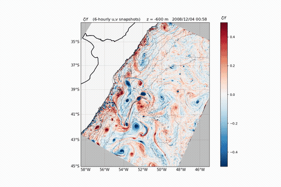
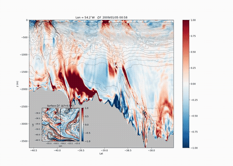
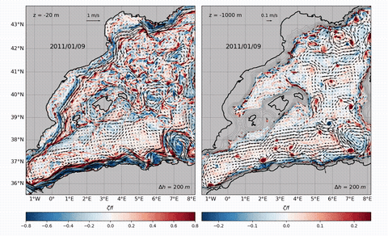

## Esther Capó — Physical Oceanography

Assistant Researcher, Department of Atmospheric and Oceanic Sciences, **University of California, Los Angeles (UCLA)**

I study **submesoscale dynamics, abyssal slope currents, flow–topography interaction and bottom boundary layers**, combining high-resolution realistic simulations (ROMS/CROCO), theory and observations.

**Website, movies and figures:** [esthercapo.github.io](https://esthercapo.github.io) · **ORCID:** [0000-0003-1788-4925](https://orcid.org/0000-0003-1788-4925) · [Google Scholar](https://scholar.google.com/citations?user=v-tz5jsAAAAJ&hl=en) · [ResearchGate](https://www.researchgate.net/profile/Esther-Capo)

  
  

COSSMoSS project, Brazil–Malvinas Current system (UCLA-ROMS, Δx = 650 m): ζ/f at 600 m depth (left) and a surface-to-seafloor section along 54.2°W (right). Click for the full movies.

  

Western Mediterranean (CROCO, Δx ≈ 1.5 km): ζ/f and velocity at 20 m and 1000 m depth.

### Research themes
- **Abyssal slope currents** — prograde (topostrophic) deep flows, downhill boundary-layer flow and diapycnal mixing on slopes
- **Bottom boundary-layer dynamics** — buoyancy and momentum balances; a 1D model for topostrophic, stratified slope BBLs
- **Submesoscale fronts and flow–topography interaction** — frontogenesis, topographic vorticity generation, Lagrangian pathways
- **Western boundary currents** — slope-controlled submesoscale variability in the Brazil–Malvinas Current system

### Models and code
[UCLA-ROMS](https://github.com/CESR-lab/ucla-roms) (CESR lab, UCLA) · [CROCO](http://www.croco-ocean.org) · [GIGATL](https://github.com/Mesharou/GIGATL) Atlantic simulations (parent solution for the Brazil–Malvinas configuration)

**Data and configurations (Zenodo):**
- Brazil–Malvinas Current System UCLA-ROMS simulation (2026) — [doi:10.5281/zenodo.21519805](https://doi.org/10.5281/zenodo.21519805)
- ALB500 UCLA-ROMS simulation (2023), for *Abyssal slope currents* — [doi:10.5281/zenodo.10215065](https://doi.org/10.5281/zenodo.10215065)
- Alb500 CROCO configuration (2023) and dataset sample (2022) — [doi:10.5281/zenodo.7814822](https://doi.org/10.5281/zenodo.7814822) · [doi:10.5281/zenodo.6827621](https://doi.org/10.5281/zenodo.6827621)
- Alb500 15-min velocity/density fields for Lagrangian analyses (2021) — [doi:10.5281/zenodo.5787070](https://doi.org/10.5281/zenodo.5787070)

### Selected publications
- Capó, E., McWilliams, J. C., Gula, J., Molemaker, M. J., Damien, P., & Schubert, R. (2024). Abyssal slope currents. *J. Phys. Oceanogr.*, 54, 2373–2392. [doi](https://doi.org/10.1175/JPO-D-24-0028.1)
- Schubert, R., Gula, J., Capó, E., et al. (2025). The ocean flows downhill near the seafloor and recirculates upward above. *Nature Communications*, 16, 5873. [doi](https://doi.org/10.1038/s41467-025-61027-2)
- Wei, H., Stewart, A. L., McWilliams, J. C., & Capó, E. (2026). Formation of abyssal downwelling-favorable prograde flows via mesoscale eddy potential vorticity mixing. *J. Phys. Oceanogr.*, 56, 1363–1385. [doi](https://doi.org/10.1175/JPO-D-25-0196.1)
- Capó, E., McWilliams, J. C., & Jagannathan, A. (2023). Flow–topography interaction along the Spanish slope in the Alboran Sea. *J. Geophys. Res. Oceans*, 128, e2022JC019480. [doi](https://doi.org/10.1029/2022JC019480)
- Capó, E., McWilliams, J. C., Mason, E., & Orfila, A. (2021). Intermittent frontogenesis in the Alboran Sea. *J. Phys. Oceanogr.*, 51, 1417–1439. [doi](https://doi.org/10.1175/JPO-D-20-0277.1)

[Full publication list →](https://esthercapo.github.io/#publications)

### Funding and recent projects
PI, U.S. NSF Award 2241754 (2023–2027) · COSSMoSS (UKRI MR/X035611/1): Brazil–Malvinas regional simulation
